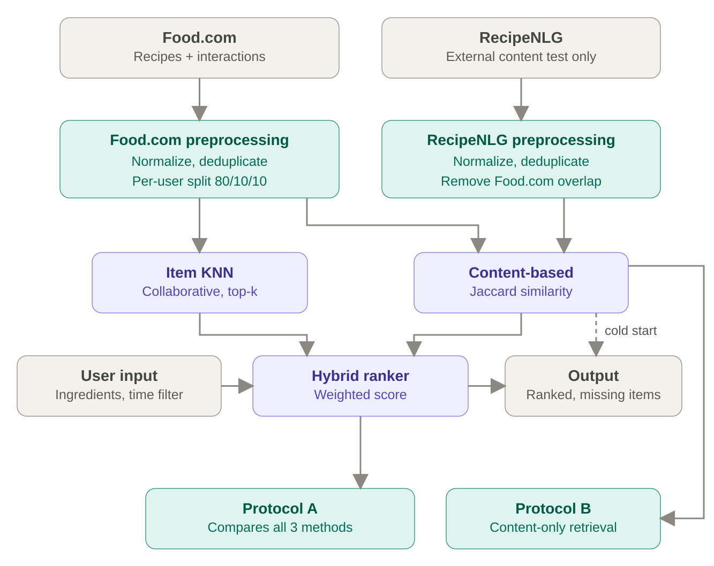

# Fridge Rescue

사용자가 냉장고에 가지고 있는 재료를 입력하면 만들 수 있는 요리를 추천하는 머신러닝 기반 개인화 레시피 추천 시스템입니다.

Food.com 데이터를 이용해 콘텐츠 기반 추천과 협업 필터링을 개발하고, RecipeNLG 데이터로 고정된 콘텐츠 기반 추천기의 외부 검색 성능을 확인합니다.

## Planned System Architecture



- Food.com의 레시피와 사용자 상호작용은 콘텐츠 기반 추천과 Item KNN 개발에 사용합니다.
- Hybrid ranker는 콘텐츠 점수와 Item KNN의 예측 선호도를 결합합니다.
- 사용자 이력이 없는 cold-start 상황에서는 콘텐츠 기반 추천 결과를 사용합니다.
- Protocol A는 Food.com에서 Content-based, Item KNN, Hybrid 세 방법을 비교합니다.
- Protocol B는 Food.com 및 RecipeNLG에서 콘텐츠 기반 레시피 검색 성능만 평가합니다.

## 개발 환경

- Python 3.11 이상 3.14 미만
- 패키지 및 가상환경 관리: [uv](https://docs.astral.sh/uv/) 권장
- 애플리케이션: Streamlit
- 테스트: pytest
- 코드 검사: Ruff

### uv로 설치

```bash
uv sync --all-extras
```

### venv와 pip로 설치

```bash
python -m venv .venv
source .venv/bin/activate
python -m pip install --upgrade pip
python -m pip install -e ".[dev,eda]"
```

## 실행 방법

Streamlit 애플리케이션을 실행합니다.

```bash
uv run streamlit run app.py
```

pip 환경에서는 다음 명령을 사용합니다.

```bash
streamlit run app.py
```

## 테스트와 코드 검사

```bash
uv run pytest
uv run ruff check .
uv run ruff format --check .
```

## 데이터 준비

원본 데이터는 라이선스와 용량 문제로 Git에 올리지 않습니다. 각 팀원이 아래 출처에서 직접 내려받은 뒤 정해진 경로에 배치해야 합니다.

먼저 저장 디렉터리를 만듭니다.

```bash
mkdir -p data/raw/foodcom data/raw/recipenlg
```

### Food.com Recipes and Interactions

1. [Kaggle Food.com Recipes and User Interactions](https://www.kaggle.com/datasets/shuyangli94/food-com-recipes-and-user-interactions)에 로그인합니다.
2. **Download** 버튼으로 데이터셋 ZIP 파일을 내려받습니다.
3. 내려받은 ZIP 파일을 `data/raw/foodcom/`에 압축 해제합니다.
4. 다음 두 파일이 정확한 경로에 있는지 확인합니다.

```text
data/raw/foodcom/RAW_recipes.csv
data/raw/foodcom/RAW_interactions.csv
```

macOS 또는 Linux에서는 저장소 루트에서 다음과 같이 압축을 해제할 수 있습니다.

```bash
unzip ~/Downloads/food-com-recipes-and-user-interactions.zip -d data/raw/foodcom
```

Kaggle CLI를 이미 설정했다면 다음 방법도 사용할 수 있습니다.

```bash
kaggle datasets download \
  -d shuyangli94/food-com-recipes-and-user-interactions \
  -p data/raw/foodcom \
  --unzip
```

### RecipeNLG

1. [RecipeNLG 공식 프로젝트](https://recipenlg.cs.put.poznan.pl/)에서 데이터 이용 조건을 확인합니다.
2. 프로젝트 사이트의 데이터셋 다운로드 안내에 따라 압축 파일을 내려받습니다.
3. 압축을 해제한 뒤 전체 레시피 CSV를 다음 경로에 배치합니다.

```text
data/raw/recipenlg/full_dataset.csv
```

내려받은 CSV의 파일명이 다르면 `full_dataset.csv`로 변경하거나 `configs/default.yaml`의 `datasets.recipenlg.recipes` 값을 실제 경로로 수정합니다.

### 배치 결과 확인

```bash
ls -lh data/raw/foodcom/RAW_recipes.csv
ls -lh data/raw/foodcom/RAW_interactions.csv
ls -lh data/raw/recipenlg/full_dataset.csv
```

세 파일이 모두 표시되면 데이터 로더를 실행할 준비가 된 것입니다. RecipeNLG 파일은 크기가 크므로 다운로드와 압축 해제를 위한 충분한 디스크 공간을 확보하세요.

데이터 출처의 이용 및 재배포 조건을 확인하고 원본 파일을 저장소에 커밋하지 마세요.

### 데이터 로더와 EDA 실행

두 데이터셋을 함께 검증하고 EDA 요약 및 그래프를 생성합니다. 기본 실행은 각 테이블의 앞 100,000행을 사용해 개발 중 메모리 사용량을 제한합니다.

```bash
uv run python -m fridge_rescue.data.eda --dataset all
```

빠른 확인을 위해 행 수를 더 줄일 수 있습니다.

```bash
uv run python -m fridge_rescue.data.eda --dataset all --max-rows 10000
```

전체 데이터를 분석하려면 `--max-rows 0`을 사용합니다. RecipeNLG는 약 2GB이므로 실행 시간이 오래 걸릴 수 있습니다.

```bash
uv run python -m fridge_rescue.data.eda --dataset all --max-rows 0
```

결과는 다음 위치에 저장됩니다.

```text
outputs/figures/
outputs/tables/eda_summary.json
outputs/tables/eda_missing_values.csv
```

### 재료 정규화와 레시피 전처리

Food.com의 `ingredients`와 RecipeNLG의 `NER` 재료 엔터티에 동일한 정규화 규칙을 적용합니다. 소문자·공백·특수문자를 정리하고, 수량과 단위를 제거하며, `configs/ingredient_synonyms.yaml`에 명시된 보수적인 동의어만 치환합니다. RecipeNLG의 수량이 포함된 원문 `ingredients` 컬럼도 결과에 그대로 보존됩니다.

```bash
uv run python -m fridge_rescue.data.preprocessing --dataset all
```

빠른 확인은 행 수를 줄여 실행할 수 있습니다.

```bash
uv run python -m fridge_rescue.data.preprocessing --dataset all --max-rows 10000
```

최종 분석용 전체 전처리는 `--max-rows 0`으로 실행합니다.

```bash
uv run python -m fridge_rescue.data.preprocessing --dataset all --max-rows 0
```

전처리 결과에는 원본 재료 목록과 정규화된 재료 목록이 함께 저장됩니다.

```text
data/processed/foodcom/recipes.parquet
data/processed/recipenlg/recipes.parquet
outputs/tables/preprocessing_report.json
outputs/tables/ingredient_normalization_examples.csv
```

`preprocessing_report.json`에는 정규화 전후 레코드 수, 제거 사유, 중복 재료 제거 수가 기록됩니다. 동의어를 추가할 때는 서로 바꿔도 의미가 유지되는 표현만 `configs/ingredient_synonyms.yaml`에 명시적으로 추가하고 표본을 다시 확인합니다.

### 누수 방지 데이터 분할과 외부 테스트 데이터

먼저 전체 레시피 전처리를 완료한 뒤 Food.com 평점 분할과 RecipeNLG 외부 테스트 카탈로그를 생성합니다.

```bash
uv run python -m fridge_rescue.data.preprocessing --dataset all --max-rows 0
uv run python -m fridge_rescue.data.splitting
```

빠른 동작 확인에서는 Food.com 상호작용 수를 제한할 수 있습니다.

```bash
uv run python -m fridge_rescue.data.splitting --max-interactions 10000
```

평점 0·결측·범위 밖 평점은 명시적 선호도에서 제외하고, 중복 사용자-레시피 평점은 가장 최근 기록을 유지합니다. 사용자별 80/10/10 분할은 고정 시드로 수행하며, 검증과 테스트를 각각 한 건씩 만들 수 없는 사용자는 train에만 포함합니다. 사용자와 레시피의 최소 활동량 기준은 train 데이터만 사용해 계산합니다.

RecipeNLG에서는 Food.com 레시피 ID가 포함된 URL과 정규화된 제목·재료 지문을 검사해 중복을 제거합니다. 이 결과는 콘텐츠 기반 외부 검색 테스트에만 사용하며 사용자 평점 정확도 평가에는 사용하지 않습니다.

```text
data/processed/foodcom/splits/train.parquet
data/processed/foodcom/splits/validation.parquet
data/processed/foodcom/splits/test.parquet
data/processed/foodcom/splits/user_activity.parquet
data/processed/foodcom/splits/recipe_activity.parquet
data/processed/recipenlg/external_test_recipes.parquet
outputs/tables/data_split_report.json
outputs/tables/recipenlg_overlap_removals.csv
```

## 프로젝트 구조

```text
Fridge-Rescue/
├── app.py                     # Streamlit 진입점
├── configs/default.yaml       # 공통 경로와 재현성 설정
├── data/
│   ├── raw/                   # 다운로드한 원본 데이터, Git 제외
│   └── processed/             # 전처리 산출물, Git 제외
├── models/                    # 학습된 모델, Git 제외
├── notebooks/                 # 탐색 및 실험 노트북
├── outputs/
│   ├── figures/               # 보고서와 발표용 그래프
│   └── tables/                # 평가 결과표
├── src/fridge_rescue/
│   ├── data/                  # 데이터 로딩과 전처리
│   ├── recommenders/          # 추천 알고리즘
│   ├── services/              # UI와 추천 모델 연결 계층
│   └── utils/                 # 공통 유틸리티
└── tests/                     # 자동화 테스트
```

## 공통 설정

기본 난수 시드는 `42`입니다. 데이터 경로, 추천 개수와 같은 공통 값은 `configs/default.yaml`에서 관리합니다. 실험 결과를 보고할 때 사용한 설정과 시드를 함께 기록합니다.

## 데이터셋 역할

- Food.com: 데이터 탐색, 전처리, 학습, 검증 및 held-out 평가
- RecipeNLG: Food.com과 중복을 제거한 뒤 콘텐츠 기반 추천의 외부 검색 테스트에만 사용

RecipeNLG에는 Food.com 사용자 평점 이력이 없으므로 협업 필터링 정확도 평가에 사용하지 않습니다.
